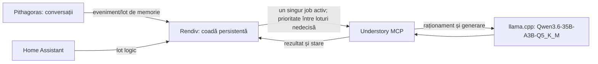

# Arhitectură: procesare asincronă a memoriei

## Scop

Rendiv va coordona conversațiile Pithagoras cu memoria semantică Understory, păstrată fără a încetini conversațiile. Procesarea memoriei trebuie să aibă loc printr-o coadă persistentă și serială. Inferența conversațională Pithagoras trebuie să aibă prioritate față de procesarea AI Understory pe serverul llama.cpp comun. Aceasta este distinctă de prioritatea relativă a loturilor din coadă, care rămâne nedecisă.

## Componente și date cunoscute

| Componentă | Rol cunoscut | Stare / observație |
|---|---|---|
| Pithagoras | Interfața conversațională și integrarea MCP cu Understory | Codul existent are integrare Understory și un API de memorie. Lista de tool-uri este expusă sub prefixul `understory_memory_*`. |
| Understory | Memorie în Markdown, cu concepte și legături semantice | MCP oferă `memory_query`, `memory_add`, `memory_update`, `memory_status` și `memory_maintain`. Adăugarea, actualizarea și mentenanța pot conduce agentul intern și pot dura minute. |
| llama.cpp | Server de inferență comun celor două aplicații | Utilizatorul a verificat runtime-ul Understory prin `docker inspect`: `LLM_MODEL=Qwen3.6-35B-A3B-Q5_K_M`, `LLM_API_BASE_URL=http://192.168.20.30:8080/v1`. Pithagoras folosește aceeași configurație conform contextului anterior, dar nu a fost reverificat în această etapă. |
| Rendiv | Coordonare și coadă persistentă planificată | Local, API-ul autentificat enqueue/status, persistența SQLite, unelte CLI de backup/verificare/restaurare și monitorizare agregată read-only sunt implementate. Workerul, dispatch-ul și procesarea bufferului nu sunt implementate. Fără deployment sau integrare externă. |
| Home Assistant | Sursă de date pentru procesare | Datele vor fi trimise în loturi logice. Understory rămâne responsabil pentru organizarea semantică. |

Contextul de operare indică un timeout MCP implicit de 60 de secunde. Acest interval este mai scurt decât unele operații Understory, care pot dura câteva minute. Prin urmare, expirarea așteptării clientului nu poate fi tratată automat drept eșecul operației din aval.

## Fluxul țintă

Diagrama reprezintă intenția de proiectare, nu implementarea actuală. Pithagoras și Home Assistant nu trebuie să aștepte procesarea semantică pentru a continua fluxul conversațional normal. Pe llama.cpp, inferența conversațională Pithagoras are prioritate față de inferența folosită de Understory.

## Cerințe de proiectare

1. **Persistență:** joburile acceptate rămân în coadă după restartul procesului Rendiv.
2. **Serializare:** cel mult un job de memorie este trimis simultan către Understory, pentru a evita concurența și disputarea modelului.
3. **Prioritatea inferenței:** inferența conversațională Pithagoras are prioritate față de procesarea AI Understory pe serverul llama.cpp comun. Mecanismul prin care se obține această prioritate trebuie investigat; detectarea activității llama.cpp nu este confirmată ca funcționalitate existentă.
4. **Ordinea loturilor:** prioritatea relativă între loturile din coadă este o decizie separată și încă nedecisă. Nu se presupune că loturile Pithagoras au prioritate față de cele Home Assistant.
5. **Conversații fără blocare:** acceptarea jobului și procesarea lui în fundal sunt separate de răspunsul conversațional.
6. **Timeout ambiguu:** timeoutul MCP nu dovedește că Understory nu a terminat. Înainte de orice retrimitere trebuie verificată starea jobului sau efectul operației.
7. **Fără duplicate:** fiecare job are o identitate stabilă/idempotency key, iar rezultatele deja aplicate sunt recunoscute înainte de reluare. Mecanismul concret rămâne de proiectat.
8. **Batch-uri Home Assistant:** păstrează loturile logice drept unitate de intrare; nu fragmentează semantic datele în Rendiv.
9. **Organizare semantică:** Understory alege conceptele, legăturile și actualizările potrivite.

## Arhitectura existentă observată

Inspecția read-only a codului Pithagoras a confirmat un serviciu gestionat pentru Understory, endpoint MCP și rutare a cererilor Understory către modelul conversației care a inițiat apelul (cu fallback la ultimul apel/modelul implicit). Codul include timpi de așteptare lungi pentru solicitările modelului din proxy. Aceste mecanisme nu constituie coada persistentă Rendiv și nu confirmă că toate apelurile MCP de memorie sunt asincrone sau reluabile.

README-ul Understory descrie un server MCP care oferă operații de citire și mutație, iar fiecare apel poate conduce un agent intern. Transportul stateless HTTP creează serverul MCP pentru fiecare cerere. Aceste observații nu confirmă existența unei interfețe de status pentru deduplicarea apelurilor sau a unei chei idempotente.

## Aspecte încă neconfirmate

- Unde va rula Rendiv și ce contract/API va folosi Pithagoras pentru a-i trimite joburi.
- Cum se va asigura prioritatea inferenței conversaționale Pithagoras pe llama.cpp față de procesarea AI Understory și dacă există mecanisme de detectare a activității llama.cpp potrivite. Această detectare trebuie investigată; nu este documentată ca implementată.
- Politica de prioritate/echitate între loturile din coadă; rămâne nedecisă separat de prioritatea inferenței Pithagoras.
- Dacă Understory poate expune un identificator de operație, stare consultabilă sau garanții de idempotency; API-ul de status necesar trebuie verificat în codul relevant înainte de implementare.
- Ce stocare persistentă va folosi coada, cum va gestiona blocările și cum va recupera un job rămas `in_progress` la restart.
- Cum se reconciliază rezultatul ambiguu după timeout înainte de retry, inclusiv pentru scrieri parțial aplicate.
- Definiția cheii de deduplicare și perioada de retenție a ei.
- Politica de prioritate/echitate, retry, backoff, dead-letter și intervenție manuală.
- Limitele de dimensiune pentru loturile Home Assistant și comportamentul la lot invalid sau parțial.
- Runtime-ul Pithagoras: configurația identică cu cea verificată prin `docker inspect` la Understory este raportată din context anterior, dar nu a fost reverificată în această etapă.
- Timeouturile reale ale clientului MCP și ale infrastructurii dintre Pithagoras, Rendiv și Understory.

Aceste puncte trebuie clarificate sau verificate înaintea implementării cozii. Până atunci, arhitectura de mai sus rămâne o specificație de intenție.
