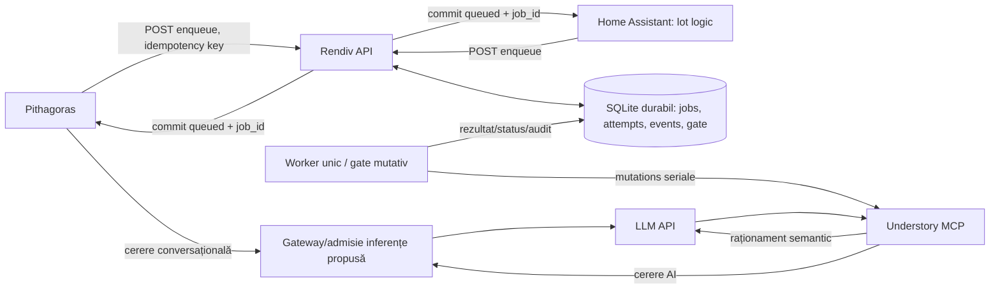

# Rendiv: arhitectură propusă pentru coada de memorie

- **Secțiune:** 01 — Proiectare Rendiv
- **Stare:** propunere tehnică; neimplementată și neaprobată pentru implementare
- **Data:** 2026-10-11
- **Baseline:** [`../baselines/BASELINE-2026-10-11.md`](../baselines/BASELINE-2026-10-11.md)

## 1. Context verificat și limite

Baseline-ul confirmă că repository-ul Rendiv conține documentație, nu o coadă sau un API de enqueue. Containerul `rendiv-studio` este prezent pe host, dar nu este tratat ca aplicația Rendiv din acest repository și nu îi atribuim codul sau rolul de worker.

Codul Pithagoras poate expune direct tool-urile MCP Understory. Understory oferă scrieri MCP, iar `/api/chat` folosește unelte de scriere; bundle-ul Understory este montat read-write. Nu există în codul Understory inspectat un job ID/status durabil sau cheie de idempotency pentru o mutație. Timeoutul MCP efectiv, modelul efectiv Pithagoras și rutele active nu sunt confirmate în runtime.

Cerințele de proiectare sunt: SQLite persistent, un singur job mutativ Understory activ, răspuns asincron către surse, prioritate pentru inferența conversațională Pithagoras și tratarea timeoutului/crashului ca rezultat posibil incert. Această secțiune descrie o soluție propusă, nu o capabilitate observată.

## 2. Soluția recomandată

Rendiv oferă API-ul autentificat de enqueue/status și deține o bază SQLite pe un filesystem local durabil. Un singur worker logic revendică joburi printr-o tranzacție SQLite scurtă și trimite mutații către Understory una câte una. Citirea statusului și acceptarea unui job nu așteaptă execuția semantică Understory.

Locația runtime Rendiv și calea volumului persistent rămân de ales. Baza trebuie să fie pe volum durabil local accesibil tuturor proceselor API/worker care o folosesc; nu se presupune că `rendiv-studio` furnizează acest volum. Nu folosiți directoarele Pithagoras sau Understory ca bază Rendiv și nu puneți SQLite pe un filesystem de rețea fără verificarea locking-ului și durabilității.



Gateway-ul pentru inferențe este o componentă propusă distinctă de worker și de ordinea joburilor. Conectarea tuturor clienților la el este o condiție pentru prioritizare efectivă; baseline-ul nu confirmă că Pithagoras, Understory sau alți clienți folosesc o astfel de poartă.

## 3. Fluxuri operaționale

### Enqueue

1. Clientul se autentifică; Rendiv derivă identitatea sursei din credential, nu dintr-un câmp liber al payloadului.
2. Clientul trimite operația permisă, payloadul, un `Idempotency-Key` stabil și un corp în limita configurată.
3. Rendiv validează schema și dimensiunea, canonicalizează JSON-ul, calculează hash-ul și încearcă inserarea într-o tranzacție.
4. Prima cerere creează UUIDv7 `job_id`, rândul `queued` și evenimentul append-only `enqueued`. Rendiv face commit și răspunde imediat cu `202 Accepted`, `job_id` și URL-ul de status.
5. Retrimiterea aceleiași chei de către aceeași sursă, cu același hash, returnează același `job_id` și starea curentă. Aceeași cheie cu hash diferit primește `409 Conflict`; nu suprascrie jobul.
6. Hash-uri identice cu chei diferite nu sunt deduplicate implicit: pot reprezenta două intenții distincte. O deduplicare semantică globală ar putea elimina scrieri legitime și nu este propusă.

### Claim și execuție

1. Workerul verifică poarta globală de mutație. Dacă există job `running` sau rezultat incert care încă poate fi activ în Understory, nu revendică alt job.
2. În `BEGIN IMMEDIATE`, selectează jobul `queued` conform politicii de ordonare aprobate, îl schimbă în `running`, rezervă poarta, adaugă attempt/event și face commit. Nicio cerere de rețea nu se ține deschisă într-o tranzacție SQLite.
3. Workerul apelează numai operația Understory autorizată pentru acel job. Payloadul este păstrat ca unitate logică; Rendiv nu îi inventează o taxonomie semantică și nu fragmentează un lot Home Assistant.
4. Numai o dovadă suficientă pentru finalizarea completă permite o tranzacție `succeeded/complete`; un raport Understory cu `changed_paths` singur este `unknown` și ține poarta ocupată. Read-back-ul poate adăuga dovezi observabile, dar nu dovedește atomicitate sau durabilitate tranzacțională.
5. `failed/none` este permis numai pentru refuz local înainte de dispatch sau pentru dovadă structurată și verificabilă de no-effect. O simplă clasificare `FAILED_NO_EFFECT` de la executor nu este probă.
6. La timeout, deconectare, crash, răspuns neclasificabil, no-op maintain fără marker explicit validabil ori rezultat parțial neclar, marchează/recuperează jobul ca `unknown`, păstrează istoricul și nu retrimite automat.

### Status și reconciliere

`GET /v1/jobs/{job_id}` citește SQLite și nu apelează Understory. Un operator cu rol separat poate consemna dovezi de reconciliere. Jobul `unknown` poate fi marcat `succeeded` numai dacă efectul este confirmat; poate reveni la `queued` numai dacă se confirmă că nicio mutație nu a fost aplicată și nu mai rulează. Dacă nu se poate confirma unul dintre aceste rezultate, rămâne `unknown`, poarta rămâne ocupată/nesigură și coada se oprește pentru a preveni concurența sau duplicarea.

## 4. Stări și serializare

Stările cerute sunt `queued`, `running`, `succeeded`, `failed` și `unknown`. Tranziții normale:

```text
queued -> running -> succeeded
                   -> failed   (eșec terminal demonstrat; efectul clasificat)
                   -> unknown  (timeout/crash/răspuns ambiguu)
unknown -> succeeded          (reconciliere confirmă aplicarea)
unknown -> failed              (reconciliere confirmă terminalitatea)
unknown -> queued              (operatorul confirmă no-effect și lipsa execuției active)
```

`failed` nu înseamnă automat „sigur de retry”: se stochează separat certitudinea efectului (`none`, `partial`, `complete`, `unknown`). Un răspuns Understory care declară fișiere schimbate înainte de eroare este rezultat parțial și nu poate fi retrimis automat. Încercările și deciziile de operator rămân în audit.

O singură poartă mutativă se aplică întregului Rendiv, nu doar unui proces worker. Constrângerea se păstrează în baza SQLite. Orice alt writer pentru bundle-ul Understory — inclusiv o cale directă MCP sau un operator — trebuie eliminat, dezactivat sau inclus în aceeași coordonare înainte de a pretinde exclusivitate globală.

Politica de ordonare a joburilor este separată de prioritizarea cererilor de inferență. Schema păstrează secvența de enqueue pentru ordonare stabilă, dar FIFO versus priorități/echitate între surse rămâne decizie deschisă conform documentelor proiectului. Claim-ul trebuie să folosească o politică explicit aprobată, nu să deducă prioritatea loturilor din prioritatea inferenței Pithagoras.

## 5. Prioritatea inferenței și `GET /slots`

Un `GET /slots` este o observație punctuală, nu o rezervare atomică. Între răspunsul „slot liber” și pornirea apelului Understory, Pithagoras poate trimite o inferență; endpointul nu blochează alți clienți, nu atribuie clase de prioritate, nu garantează loc pentru conversația următoare și nu eliberează o cerere deja pornită. Semantica și disponibilitatea acestui endpoint pentru serverul llama.cpp efectiv nu au fost verificate la runtime.

**Mecanism realist propus:** un gateway unic de admitere pentru toate cererile relevante către model, care autentifică callerii și clasifică cererile Pithagoras drept interactive, iar cererile Understory de worker drept background. Înainte de a admite următoarea cerere background, gateway-ul verifică cererile interactive în așteptare și le servește primele. Understory trebuie configurat să folosească gateway-ul; toate căile Pithagoras și ceilalți clienți trebuie inventariați și rutați prin aceeași poartă. Workerul Rendiv pornește numai cu token/admitere background, nu doar după un `GET /slots`.

Gateway-ul nu întrerupe brutal o cerere Understory deja admisă. Dacă modelul are un singur slot și nu suportă preempție sigură, o cerere conversațională începută în timpul acelei inferențe poate aștepta terminarea ei. Pentru o limită strictă de așteptare conversațională este necesară capacitate interactivă rezervată, scheduling nativ cu clase de prioritate ori instanță/model separat. Aceste opțiuni depind de capabilități și resurse runtime încă neconfirmate.

Un `GET /slots` poate fi telemetrie auxiliară pentru diagnostic, dacă se confirmă suportul și schema lui; nu este mecanismul de coordonare sau dovada priorității.

## 6. Alternative evaluate

| Opțiune | Decizie | Motiv |
|---|---|---|
| SQLite durabil în Rendiv, API asincron și un singur gate/worker | Recomandată pentru prima versiune | Cerințele cer SQLite și serializare; acceptarea jobului nu depinde de durata Understory; state și audit pot fi tranzacționate local. |
| Coadă numai în memorie / timer Pithagoras | Respinsă | Se pierde la restart și nu acoperă apelurile MCP directe. |
| Verificare `GET /slots` înainte de fiecare mutație | Respinsă ca mecanism de prioritate | Este check-then-act cu cursă și nu rezervă/admite atomic. |
| Retry automat după timeout MCP | Respinsă | Timeoutul nu dovedește lipsa efectului; Understory nu oferă status/idempotency per mutație confirmate. |
| Understory drept proprietar al cozii fără API nou de status | Respinsă pentru prima versiune | API-ul inspectat execută mutații direct și nu expune job lifecycle durabil. Poate fi reevaluată dacă Understory adaugă un contract durabil și idempotent. |
| Redis/broker extern în locul SQLite | Amânată | Ar adăuga infrastructură și două surse de adevăr, în timp ce SQLite este cerința explicită. Poate fi reevaluată dacă volumele/locking-ul local ori debitul cer alt broker. |
| Preempție/kill al mutației Understory active | Respinsă | Poate lăsa scrieri parțiale și nu respectă cerința de a nu întrerupe brutal operațiile începute. |
| Gateway comun de inferență cu capacitate rezervată sau instanță separată | Alternativă necesară pentru garanție strictă | Oferă o bază tehnică pentru prioritate, dar necesită verificarea compatibilității, resurselor și rutării tuturor clienților. |

## 7. Riscuri și limite

- Fără operație Understory cu status/idempotency, unknown poate necesita reconciliere manuală și bloca temporar coada. Acesta este costul alegerii siguranței față de duplicate.
- Rendiv poate serializa numai scrierile care trec prin el. MCP direct, `/api/chat`, CLI și editarea fișierelor ocolesc gate-ul până la migrare și control de acces.
- SQLite cere un filesystem cu locking local fiabil. Directorul și forma backup-ului trebuie alese înainte de implementare; un bind mount nu este, singur, backup.
- „Prioritate” fără gateway comun sau rezervă de capacitate poate reduce concurența pornită de worker, dar nu poate garanta zero întârziere când Understory ocupă deja singurul slot.
- Retenția payloadurilor, criptarea la rest și limitele de volum sunt decizii operaționale deschise; payloadul poate conține informații personale și nu trebuie copiat în loguri/telemetrie.
- Nu sunt cunoscute limitele runtime ale API-urilor Pithagoras/Understory, timeouturile efective, versiunea SQLite și topologia viitoare de deploy Rendiv.

## 8. Decizii arhitecturale încă deschise

1. Unde rulează serviciul/API-ul Rendiv și pe ce volum local durabil stă SQLite.
2. Dacă API-ul are un singur proces sau mai multe instanțe; toate trebuie să partajeze același fișier și același gate local.
3. Politica de ordonare/echitate între loturile Pithagoras, Home Assistant și alte surse.
4. Contractul Understory pentru reconcilierea unei operații necunoscute și dacă se poate adăuga ulterior status/idempotency la destinație.
5. Gateway-ul de inferență: compatibilitate, identitatea callerului, rezervarea capacității și limita realistă de întârziere interactivă.
6. Timeouturi configurate pentru enqueue, client MCP, Understory și gateway; acestea trebuie măsurate/verificate, nu preluate ca valori runtime din context.
7. Limitele de payload, backlog, rata per sursă și retenția/anonymizarea datelor.
8. Autentificarea serviciu-la-serviciu, distribuția/rotația credentialelor și rolul operatorilor de reconciliere.
9. Politica de backup/restore, RPO/RTO, monitorizare și condițiile de rollback.

## 9. Criterii de acceptare pentru o implementare ulterioară

- Un enqueue valid face commit înainte de `202`; aceeași cheie și același payload returnează același `job_id`; aceeași cheie cu alt hash este respinsă fără suprascriere.
- Procesul API nu așteaptă finalizarea Understory; `GET` status funcționează în timp ce workerul rulează.
- Două cereri concurente de claim nu pot pune două mutații în zbor; constraint/gate-ul SQLite și auditul demonstrează exclusivitatea.
- Restartul înainte de dispatch păstrează joburile queued. Restartul după claim nu redespachetează automat jobul; acesta devine `unknown`, iar gate-ul nu eliberează un al doilea job până la reconciliere.
- Refuzul local înainte de dispatch sau dovada structurată/verificabilă no-effect poate deveni `failed/effect_certainty=none`; enum-ul executorului singur nu este suficient. Răspunsul parțial neclar, timeoutul/crashul ambiguu și succesul doar raportat prin `changed_paths` devin `unknown` fără retry. Un no-op maintain devine terminal numai pe baza confirmării explicite, neambigue și validabile că s-a încheiat fără modificări.
- Fiecare tranziție și intervenție este append-only; payloadurile și credentialele nu apar în loguri, API status sau metrici.
- Integrarea Pithagoras și Home Assistant returnează job ID fără să aștepte procesarea semantică; batch-urile HA rămân unități logice, iar oversized payload este respins explicit.
- Testul de acceptanță pentru prioritate demonstrează că o cerere Pithagoras în așteptare precede admiterea unei cereri Understory noi; limita unei cereri Understory deja active este măsurată și documentată. Nu se întrerupe brutal nicio mutație.
- Backup-ul SQLite poate fi restaurat într-un mediu izolat și păstrează stările, legăturile și auditul. Configurația de restore nu pornește automat joburi `unknown`.
- Căile directe mutative identificate sunt blocate, proxy-ate sau explicit inventariate și controlate înainte de a declara Rendiv punct unic de scriere.

## 10. Secvența propusă pentru implementare

1. Clarifică deciziile deschise fără accesarea sau publicarea secretelor; fixează contractele și limitele.
2. Proiectează și aprobă API-ul, schema de stări, clasificarea certitudinii și procedura manuală de reconciliere.
3. Implementează SQLite și API-ul de enqueue/status fără dispatch activ; validează în mediu izolat.
4. Implementează un worker cu gate unic, audit append-only și recovery fail-closed; verifică timeout/crash/backup în Understory de test.
5. Integrează mecanismul comun de admitere LLM și demonstrează comportamentul de prioritate cu toate căile necesare.
6. Migrează o sursă la un moment dat în modul controlat, eliminând bypass-urile după validare și păstrând rollback cu reconciliere.
7. Activează operarea graduală cu alerte, backup verificat și runbook pentru `unknown`; nu activa retry automat pentru rezultate ambigue.

Această documentație nu autorizează implementarea. Implementarea începe numai după aprobarea explicită a secțiunii de proiectare și rezolvarea deciziilor care blochează siguranța operațională.
