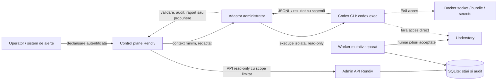

# Rendiv: administrator inteligent prin Codex CLI

- **Secțiune:** 01B — Administrator Codex CLI
- **Stare:** propunere tehnică; neimplementată și neaprobată pentru implementare
- **Data:** 2026-10-11
- **Arhitectură de coadă:** [`01-ARCHITECTURE.md`](01-ARCHITECTURE.md)
- **Bază de date:** [`01-DATABASE.md`](01-DATABASE.md)
- **Integrare:** [`01-INTEGRATION.md`](01-INTEGRATION.md)
- **Baseline:** [`../baselines/BASELINE-2026-10-11.md`](../baselines/BASELINE-2026-10-11.md)

## 1. Scop și limite

Codex CLI este propus ca administrator inteligent al serviciului Rendiv: inspectează starea expusă cu acces limitat, explică anomalii și pregătește recomandări auditate pentru operatori. Nu procesează semantic memoria și nu execută joburi din coada Rendiv. Understory rămâne componenta care interpretează și organizează semantic memoria; workerul Rendiv rămâne singurul executor al joburilor mutative acceptate prin coadă.

La data baseline-ului, repository-ul Rendiv nu conține implementarea cozii, API-ul administrativ sau adaptorul Codex CLI descris aici. Această propunere nu afirmă că agentul, endpointurile, autentificarea, izolarea sau fluxurile sunt deja configurate. Nici containerul `rendiv-studio`, nici interfața sa nu sunt presupuse ca parte a aplicației Rendiv.

Documentația Codex CLI descrie `codex exec` pentru utilizare non-interactivă, ieșire JSONL și sandbox read-only implicit; aceleași documente arată că setările pot proveni din configurații pe mai multe niveluri și că argumentele CLI au precedență. Prin urmare, proiectarea fixează explicit configurația și mediul de execuție, fără să trateze valoarea implicită ca unic control de securitate. [Mod non-interactiv Codex CLI](https://learn.chatgpt.com/docs/non-interactive-mode), [configurație Codex](https://learn.chatgpt.com/docs/config-file/config-basic).

## 2. Arhitectura recomandată

### Componente

1. **Control plane Rendiv** primește cererea operatorului ori un eveniment de alertă, aplică ACL-uri, decide dacă o rulare este permisă și atribuie `admin_run_id`. El colectează numai datele strict necesare dintr-un API administrativ read-only și înregistrează declanșatorul și limitele rularii.
2. **Adaptorul Codex CLI** construiește contextul redactat, pornește `codex exec` ca proces separat, impune deadline și limite locale, captează progresul/resultatul și validează schema rezultatului. Adaptorul nu este worker de coadă și nu are drept de a crea, revendica sau executa joburi.
3. **Mediul de execuție** este un container/VM sau sandbox de sistem de operare dedicat, cu utilizator fără privilegii, sistem de fișiere temporar și acces de rețea restrâns. Sunt preferate un workspace efemer și o configurație Codex dedicată, controlată de serviciu. Nu se montează socket Docker, bundle-ul Understory, volumele de date Pithagoras/Understory sau directoare cu credențiale Rendiv.
4. **API-ul administrativ read-only** expune numai vizualizări proiectate pentru operator: sănătate, numărători pe stări, vechimea joburilor, istoricul tranzițiilor fără payload și referințe la audit. El nu reutilizează rutele de enqueue, reconciliere ori controlul workerului cu un token privilegiat.
5. **Workerul Rendiv** rămâne un proces separat, cu identitate tehnică separată și singurul drept operațional de dispatch mutativ. Oprirea, blocarea sau compromiterea administratorului Codex nu afectează dispatch-ul ori conversațiile Pithagoras.

Codex poate propune interpretări și pași de diagnostic; doar componentele deterministe decid sănătatea, alertele de prag, validitatea ACL și tranzițiile de stare. Rezultatul LLM nu este sursă de adevăr pentru starea unui job.

### Execuție și integrare API

Adaptorul oferă lui Codex un set fix de instrumente administrative, prin API-uri locale tipate sau un proxy de instrumente controlat. Nu expune shell general, MCP Understory, API Docker ori URL-uri arbitrare. Dacă se folosește MCP pentru unelte administrative interne, serverul oferă strict metode read-only și este pornit de adaptor cu schema/versionare fixe; nu este serverul MCP de memorie Understory.

Rezultatul Codex este JSON validat cu o schemă versionată: `summary`, `observations[]`, `evidence_refs[]`, `uncertainties[]`, `recommended_actions[]` și severitate/expirare. Rezultatul nu este executabil și nu poate modifica roluri, permisiuni sau allowlist-uri. Ieșirea invalidă, incompletă ori expirată este respinsă ca diagnostic neutilizabil. Pentru `codex exec`, ieșirea de progres merge separat de rezultatul final; adaptorul păstrează doar referințe și metadate necesare auditului.

Autentificarea Codex este o identitate dedicată serviciului, cu acces minim și gestionată în afara contextului vizibil agentului. Documentația CLI descrie autentificarea salvată și utilizarea `CODEX_API_KEY`; alegerea metodei, planul/entitlement-ul și limitele contului sunt decizii de operare de verificat, nu proprietăți confirmate ale runtime-ului Rendiv. Cheile nu se trec ca prompt, context, argument, log sau variabilă disponibilă comenzilor copil. Preferința este un broker/proxy de autentificare sau un secret montat numai procesului CLI într-un sandbox fără acces de agent la acel fișier; dacă izolarea nu poate împiedica citirea cheii de către procesele copil, integrarea nu se activează.

## 3. Capabilități propuse

| Capabilitate | Comportament permis | Limită |
|---|---|---|
| Monitorizare | Rezumă health checks, stări și vechime backlog din API-ul Rendiv | Sursa deterministă de stare rămâne Rendiv; Codex nu deduce succesul din textul logurilor |
| Detectarea `unknown` | Evidențiază jobs `unknown`, blocarea gate-ului și lipsa dovezilor de reconciliere | Nu reîncearcă, nu eliberează gate-ul și nu decide singur efectul Understory |
| Diagnostic | Corelează evenimente tehnice redactate, erori sigure și versiuni declarate | Nu inspectează memoria, payloadul integral, secretele sau filesystem-ul bundle |
| Comparare baseline | Compară configurații non-secrete aprobate și semnalează drift | Baseline-ul este referință; diferența nu autorizează remediere |
| Rapoarte | Produce raport de audit cu fapt, sursă, ipoteză, incertitudine și recomandare distincte | Nu rescrie automat documente sau configurații fără un flux de aprobare separat |
| Alerte | Adaugă explicație la o alertă deterministă și grupează semnale corelate | Regula/threshold-ul de alertă nu este înlocuit de judecata modelului |
| Mentenanță | Identifică backup lipsă, spațiu redus, coadă stagnantă sau drift și propune runbook | Nu face vacuum, cleanup, restore, rotație, deploy ori restart automat |

Accesul la conținutul payloadurilor sau al conversațiilor nu este necesar pentru funcțiile de bază. Recomandarea este de a furniza agregări și referințe de audit, nu textul joburilor. Dacă un diagnostic viitor ar necesita date sensibile, trebuie proiectate separat minimizarea, redactarea și aprobarea acelui input.

## 4. Permisiuni și controale tehnice

### Niveluri de acces

| Nivel | Activități | Autorizare |
|---|---|---|
| Observare | Citire health/stări/metrici și inventar non-secret | Automat, cu identitate read-only și scope separat per serviciu |
| Diagnostic | Corelare de evidențe redactate și generare raport | Automat la cerere/alertă, în sandbox; fără mutații sau acces de rețea liber |
| Intervenție propusă | Pregătirea unei acțiuni tipate, cu țintă, motiv, efect anticipat și risc | Codex doar propune; un operator uman autentificat aprobă explicit |
| Execuție intervenție | Acțiuni în allowlist printr-un serviciu de control distinct | Aprobare legată de propunerea exactă, actor, resursa/state version și expirare; audit complet |

Aprobarea nu este un mesaj în prompt, o instrucțiune din log ori un rezultat al modelului. Este un eveniment independent dintr-o interfață/operator API autentificat. Operatorul revizuiește difful exact, ținta, efectul, impactul și evidențele. Schimbarea stării între propunere și aprobare invalidează aprobarea; cererea trebuie reevaluată. Acțiunile cu impact mare pot cere doi operatori, conform unei politici încă de stabilit.

### Izolare și minimizare

- Rulează cu utilizator OS fără privilegii, limite CPU/memorie/procese și filesystem temporar read-only, cu excepția unui director scratch gol care se șterge după execuție.
- Fără Docker socket, `docker` CLI accesibil, host PID/network, mount-uri cu Understory/Pithagoras, bundle, chei, fișiere `.env`, istoricul conversațiilor sau credentiale ale workerului.
- Egress deny-by-default. Permite numai endpointul de autentificare/model Codex și proxy/API-ul read-only necesar; lista exactă de hosturi și protocol se decide înainte de deployment. Nu permite acces direct la MCP Understory, llama.cpp ori rețele de operare.
- API-ul read-only aplică allowlist de rute și câmpuri la server, nu se bazează pe instrucțiuni prompt pentru a refuza scrieri. Tokenul Codex și tokenul de observare sunt separate; niciunul nu acordă control de worker.
- Dezactivează pluginuri/skill-uri și configuri locale neaprobate pentru acest serviciu; pin-uiește versiunea/configurația CLI după validare. Ignoră override-urile din workspace neîncredere și verifică effective config la pornire.
- Redactează loguri, stderr, stdout, JSONL și telemetrie înainte de stocare; nu salva promptul complet sau ieșiri care ar putea include date personale. Politica exactă de retenție este deschisă.

Sandbox-ul read-only al CLI este un strat suplimentar, nu controlul unic: limita tehnică vine din sandboxul procesului/containerului, ACL-ul API, rețeaua și absența credentialelor privilegiate. Configurațiile Codex pot fi moștenite din mai multe niveluri, deci adaptorul trebuie să utilizeze un mediu dedicat și să verifice setările efective înainte de execuție. [Configurație Codex](https://learn.chatgpt.com/docs/config-file/config-basic).

## 5. Siguranță și comportament la incidente

1. **Fără retry pentru `unknown`:** administratorul poate detecta și explica starea. Nu poate re-enqueue, redispatch, reseta gate-ul sau transforma `unknown` în `failed`. Reconcilierea urmează fluxul separat documentat în arhitectura bazei; necesită dovezi și actor autorizat.
2. **Fără scriere directă Understory:** niciun instrument, shell, MCP sau endpoint din sandbox nu are rută de scriere Understory. Doar workerul Rendiv poate dispatch-ui joburile acceptate. Accesul administratorului la `memory_add`, `memory_update`, `memory_maintain`, `/api/chat` mutativ sau `/bundle` este interzis.
3. **Fără restart neaprobat:** Codex nu poate opri/reporni servicii sau containere. O eventuală acțiune de restart este doar propunere, verificată de runbook și aprobată prin control plane separat; nu se acordă socket Docker nici în urma aprobării.
4. **Audit append-only:** pentru fiecare rulare se înregistrează `admin_run_id`, trigger/actor, versiune CLI/config/schema, setul de surse consultate, timestamp, deadline, cod de ieșire, starea validării, referințe la dovezi, sumarul rezultatului și dacă/ce aprobare umană a urmat. Payloadul, secretele și conținutul memoriei nu se copiază în audit. Politica de retenție/immutabilitate și protecția contra operatorilor privilegiați rămân de decis.
5. **Prompt injection:** toate logurile, textul de eroare, titlurile joburilor și documentele sunt date neîncredere, nu instrucțiuni. Se trimit doar câmpuri minimizate și delimitate; nu se oferă capacitatea de a crea tool-uri, modifica politica sau citi alte fișiere. Răspunsurile sunt validate prin schemă și nu se execută ca shell/SQL/HTTP. Protecția promptului singură nu este suficientă; izolarea și scope-ul server-side sunt obligatorii.
6. **Timeout și limite:** fiecare rulare are hard deadline, plafon de tokens/output, limite de concurență per tenant/sistem și cooldown pentru alerta repetată. Valorile se stabilesc pe baza limitelor Codex/contului și a SLO-urilor; nu sunt confirmate în baseline și nu sunt inventate aici. La depășire, rularea se închide, se auditează `timed_out`, iar datele parțiale nu devin acțiuni.
7. **Crash/restart:** crash-ul adaptorului sau restartul control plane nu afectează workerul și nu reia acțiuni. Rularea administrativă incompletă devine `interrupted`; următoarea rulare este una nouă, read-only, cu `admin_run_id` nou. Nu există acțiuni în așteptare executate automat la recovery.
8. **Indisponibilitate Codex:** health checks și alertele deterministe continuă. Se afișează „diagnosticul AI indisponibil”, fără fallback la acces direct ori la alt model neconfigurat. Cererile on-demand pot fi reîncercate de operator ca rulări noi, în limita ratei; aceasta nu este retry de job Understory.

## 6. Operare și separarea fluxurilor

### Declanșare

- **La cerere:** operatorul autenticat cere un raport sau diagnostic pe un scope explicit; scope-ul este validat de control plane.
- **La alertă:** o regulă deterministă poate porni o analiză read-only pentru clase allowlist, cu deduplicare/cooldown și plafon de concurență. Alertele de securitate care implică date sensibile folosesc numai sumarul redactat.
- Nu se pornește Codex pentru fiecare mesaj Pithagoras sau fiecare job de coadă. Serviciul este plan administrativ cu scheduling separat și buget operațional propriu.

### Flux critic și resurse

Workerul și API-ul enqueue/status nu așteaptă Codex. Nu există call sincron de agent pe calea conversației Pithagoras și nu se ține tranzacție SQLite deschisă pe durata unei analize. Administratorul poate fi oprit sau limitat fără a bloca conversațiile ori coada. Resursele Codex, concurența, bugetul și rata sunt izolate de worker; configurația efectivă de inferență Codex și orice eventuală competiție pe resurse nu sunt cunoscute în baseline.

Dacă serviciul Codex sau credentialul său este indisponibil, operatorul primește evenimentul brut redactat și runbook-ul determinist. Nu se acordă fallback la Understory, la modelul llama.cpp comun sau la credențiale mai privilegiate.

### Autentificare și limite Codex

Trebuie confirmate înainte de implementare: metoda suportată de autentificare non-interactivă pentru contul ales, drepturile/licența, rate limits și bugetul, regiunea/endpointul permis, datele care pot fi transmise și retenția lor. Documentația CLI descrie modurile de autentificare disponibile, dar acestea nu confirmă ce abonament sau limită are Rendiv. Cheile rămân numai în secret manager/broker și nu sunt incluse în apeluri de diagnostic sau artefacte.

### UI viitor

Un UI Rendiv ulterior poate solicita rapoarte, afișa dovezi și prezenta aprobări, folosind API-ul de control plane. UI-ul nu comunică direct cu Codex CLI, Docker sau MCP Understory. Nu se presupune că `rendiv-studio` observat în baseline este produsul Rendiv, că aparține proiectului sau că este interfața potrivită. Alegerea UI și integrarea sa sunt decizii separate.

## 7. Reconcilierea joburilor `unknown`

Administratorul Codex sprijină reconcilierea, nu o automatizează. Poate aduna din API-ul Rendiv și din auditul append-only dovezi read-only precum: `job_id`, starea/gate-ul, numărul încercării, timestamps, dacă a fost înregistrată intenția de dispatch, codurile de răspuns disponibile și tranzițiile. Referințele la loguri trebuie să fie redactate și controlate prin ACL.

Dovezile pot indica un refuz local înainte de dispatch sau pot arăta că s-a primit un răspuns complet, dacă aceste fapte sunt înregistrate sigur. Absența unui răspuns după trimitere nu demonstrează că Understory nu a aplicat mutația. O verificare read-only a stării actuale poate fi incompletă, poate omite efecte parțiale și nu stabilește întotdeauna cauzalitatea. `memory_status` nu este status per job. Nu se interoghează automat memoria sau bundle-ul pentru a căuta efecte.

Flux propus:

1. Codex redactează o cronologie și listează ce se știe, ce nu se știe și dovezile folosite; nu schimbă `job.state` sau gate-ul.
2. Operatorul examinează sursele primare prin interfețele read-only autorizate. Dacă e nevoie de inspecție de memorie/Understory, aceasta necesită un flux separat și nu este acordată implicit administratorului Codex.
3. Un operator cu rol de reconciliere alege rezultatul permis de schema Rendiv (`applied`, `not_applied`, `partial` sau `still_unknown`, dacă acestea sunt stările acceptate de implementarea viitoare), oferă motiv/evidență și confirmă că nu există execuție încă activă înainte de o eventuală re-queue.
4. Control plane verifică rolul, starea curentă/versionarea, cerința de aprobare suplimentară și validează tranziția conform regulilor database. Orice tranziție este append-only și atribuită unui actor uman.
5. Dacă dovezile nu sunt suficiente, jobul și gate-ul rămân `unknown`; nu se face retry și se escaladează către owner-ul Understory.

Numele valorilor de reconciliere de la punctul 3 sunt propuneri de interfață, nu enum-uri confirmate în cod; schema efectivă trebuie aliniată la `01-DATABASE.md` înainte de implementare. Rezultatul text al Codex este recomandare, niciodată autorizare sau probă primară.

## 8. Alternative evaluate

| Alternativă | Decizie | Motiv |
|---|---|---|
| Codex CLI într-un adaptor administrativ separat, cu API read-only și sandbox | **Recomandată** | Delimitează rolul, oferă diagnostic asistat și păstrează workerul/coada independentă. |
| Codex ca worker care ia joburi și scrie semantic în Understory | Respinsă | Încalcă separarea rolurilor, serializarea și responsabilitatea semantică Understory; amplifică riscul prompt injection și al rezultatului incert. |
| Codex chemat sincron la fiecare conversație sau enqueue | Respinsă | Pune disponibilitatea/latency/bugetul modelului pe calea critică și poate bloca acceptarea asincronă. |
| Codex cu acces root și Docker socket pe host | Respinsă | O eroare sau prompt injection poate deveni control total asupra containerelor, volumelor și secretelor. |
| Remediere automată pe baza textului modelului | Respinsă | Textul nu este dovadă autorizată, nu este determinist și poate conține instrucțiuni injectate. |
| Monitorizare numai cu reguli și fără Codex | Alternativă viabilă | Mai simplă și deterministă; recomandată ca nivel obligatoriu de bază, dar oferă explicații și triere mai limitate. |
| UI de administrare legat de `rendiv-studio` | Respinsă ca presupunere | Baseline-ul nu confirmă că acesta aparține proiectului Rendiv. API-ul de control trebuie să rămână independent de UI. |

## 9. Riscuri și limitări

- Codex poate formula o explicație plauzibilă dar greșită; numai evenimentele primare și operatorul decid starea și acțiunea.
- Datele operaționale trimise la serviciul Codex pot conține identificatori sau informații sensibile. Redactarea, clasificarea datelor, retenția și endpointul trebuie aprobate înainte de activare.
- Sandbox-ul CLI singur nu protejează dacă procesul are secrete, socket-uri, filesystem ori rețea prea largă. Toate straturile de control trebuie validate efectiv.
- Autentificarea, limitele de rată, disponibilitatea, costurile și politica de retenție Codex pentru contul Rendiv sunt necunoscute.
- Diagnosticarea `unknown` este fundamental limitată când Understory nu expune ID/status/idempotency per mutație; adminul nu poate dovedi neaplicarea doar din timeout.
- Un administrator automat pornit prea des poate consuma buget și poate aglomera serviciile de observabilitate. Deduplicarea alertelor și cap-ul de concurență trebuie stabilite.
- Aprobările pot deveni stale, pot viza resursa greșită sau pot fi manipulate de datele de intrare; binding-ul la snapshot/state version și expirarea sunt obligatorii.
- Orice rezultat sau audit poate dezvălui payload dacă nu există o politică de allowlist/redactare. Hash-urile de payload nu se expun by default.
- UI-ul, mediul de execuție, endpointul Rendiv și procesul de autentificare Codex sunt decizii viitoare, nu componente runtime confirmate.

## 10. Criterii de acceptare pentru implementarea viitoare

1. Pornirea la cerere și declanșarea controlată de alertă generează `admin_run_id`; execuțiile repetate sunt limitate prin cooldown și plafon de concurență.
2. Rularea CLI folosește versiune/configurație fixate și sandbox verificat; accesul la Docker socket, Understory MCP/API/bundle, secrete și payloaduri este tehnic refuzat, nu doar interzis prin prompt.
3. API-ul expus agentului este read-only, allowlistat server-side și nu poate crea/enqueue, revendica, reconcilia sau executa joburi.
4. Workerul continuă să servească joburile sale indiferent dacă procesul Codex este oprit, lent, rate-limited sau indisponibil; niciun enqueue/status conversațional nu așteaptă adminul.
5. Loguri și payloaduri care conțin instrucțiuni ostile nu extind toolset-ul, scope-ul, accesul la rețea sau permisiunile; răspunsul este verificat după o schemă și nu se execută.
6. `unknown` nu declanșează retry, eliberarea gate-ului sau modificare de stare; Codex poate doar produce evidențe și recomandări.
7. Nu se execută restart sau altă intervenție fără aprobarea umană autentificată, legată de propunerea exactă și starea actuală; aprobarea stale este respinsă.
8. Fiecare rulare, sursă de evidență, rezultat/eroare, aprobare și acțiune executată este auditată fără secrete, payload integral ori conținut de memorie.
9. La timeout, crash, JSON invalid, serviciu Codex indisponibil ori buget/rate-limit atins, rularea eșuează în siguranță, alertarea deterministă continuă și nu se declanșează acțiuni.
10. Compararea baseline-ului marchează separat confirmat/neconfirmat/risc și nu tratează valori deduse din sursă ca valori runtime.
11. Interfața viitoare folosește API-ul Rendiv și nu depinde de `rendiv-studio` până la o decizie explicită de proprietate și integrare.

Acestea sunt criterii de proiectare; nu au fost executate teste sau controale runtime pentru această propunere.

## 11. Secvența propusă de implementare

1. **Clarificări și threat model:** stabilește operatorii, datele acceptabile pentru Codex, metoda/licența de autentificare, limitele contului, retenția, endpointurile și responsabilitatea aprobărilor. Confirmă sursele de evidență fără a expune secrete.
2. **Contract administrativ:** definește API read-only și DTO-uri redactate, roluri/scopes, identificatorii de audit, schema de ieșire și versionarea. Leagă stările de reconciliere de schema aprobată în `01-DATABASE.md`.
3. **Monitorizare deterministă:** implementează health checks, alerte de backlog/`unknown` și raportarea indisponibilității fără Codex. Păstrează această cale funcțională independent.
4. **Sandbox și adaptor:** fixează CLI și configurația efectivă, configurează execuția efemeră read-only, egress allowlist, hard deadline, limite de resurse și procesare JSONL/schemă; demonstrează refuzul accesului la resurse excluse într-un mediu izolat.
5. **Diagnostic read-only:** adaugă rulare on-demand și apoi trigger de alertă cu context minim redactat, audit și cooldown. Nu conecta niciun instrument de mutație.
6. **Reconciliere asistată:** afișează dovezile și recomandarea către operator. Păstrează decizia și tranziția în interfața separată de reconciliere Rendiv; Codex nu execută tranziția.
7. **Acțiuni cu aprobare, opțional:** numai după revizie de securitate, adaugă allowlist restrânsă prin control plane independent, binding la snapshot, expirare și audit. Nicio aprobare nu acordă acces la Docker socket sau Understory direct.
8. **UI și operare:** alege explicit dacă este necesar un UI Rendiv, definește runbook-uri, rotație credentiale, retenție, bugete și alarmare; integrează UI-ul prin API-ul propriu Rendiv.

Această secțiune nu autorizează implementarea sau deployment-ul. Implementarea începe numai după aprobarea explicită și clarificarea deciziilor de securitate, autentificare, retenție și operare.
